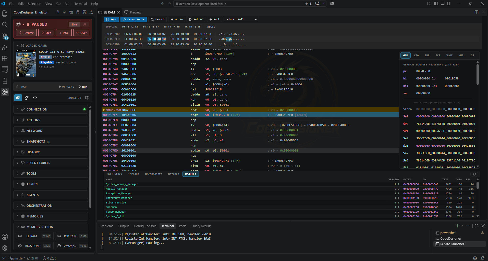
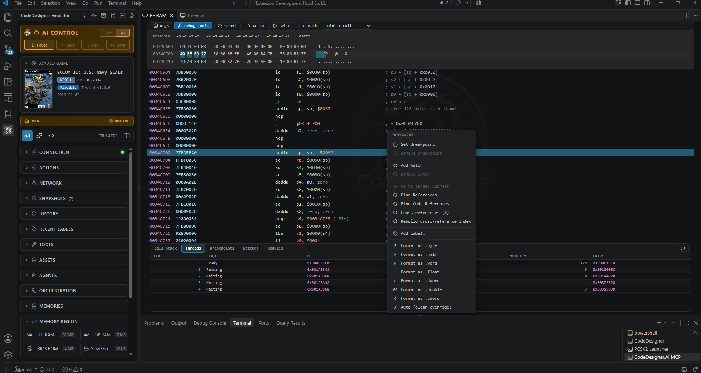
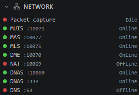
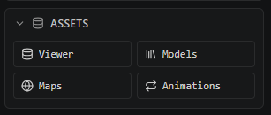

<p align="center">
  
</p>

<h1 align="center">CodeDesigner PS2</h1>

<p align="center">
  A PlayStation 2 reverse-engineering and modding workbench built into VS Code.
</p>

---

CodeDesigner assembles and disassembles the Emotion Engine (MIPS R5900), debugs games live in its own PCSX2 fork or PX86, builds and ports cheats, edits game assets, and runs online servers. Its MCP server exposes many of the same capabilities to compatible AI assistants, so a developer and an assistant can work within the same reverse-engineering workflow. Enable AI mode in the client to observe supported AI actions as they happen.

> **Get started:** run `CodeDesignerInstaller.exe` from the [latest release](https://github.com/FatalityDevelopment/CodeDesignerPS2/releases/latest). See [Getting started](#getting-started).

## Contents

- [What it does](#what-it-does)
- [Architecture](#how-it-fits-together)
- [Feature showcase](#feature-showcase)
  - [Workspace and debugger](#integrated-codedesigner-workspace)
  - [SOCOM II online and networking](#socom-ii-multiplayer-dnas-and-patch-server)
  - [Memory, labels, and cheats](#live-labels-and-memory-mapping)
  - [AI-assisted reverse engineering](#ai-assisted-reverse-engineering-with-mcp)
  - [Asset editing and map building](#asset-editor-map-builder-and-asset-converter)
- [Getting started](#getting-started)
- [AI assistants (MCP)](#ai-assistants-mcp)
- [Repository layout](#repository)
- [Documentation](#documentation)
- [Related projects](#related-projects)

## What it does

| Area | Highlights |
|---|---|
| **Disassembler** | Live views of every memory region; comment hints, function and table detection, cross-references, breakpoints, watches, registers. Full R5900 ISA including MMI, FPU, VU0 macro and VU1. |
| **Emulators** | Debugs commercial games in CodeDesigner's **PCSX2 fork** over PINE (breakpoints, stepping, symbols, save states, pad, network, live picture, sound), or in the built-in dual-CPU emulator. |
| **CDS language** | A patch scripting language that compiles to MIPS, GameShark codes or a frame-loop cheat table. |
| **Cheats** | Cheat lists and the CheatCodeArchive, format conversion, a cheat porter between game versions, a frame-loop cheat engine and a joker (button activator) code builder. |
| **Memory tools** | Memory Diff, PCSX2 save states, scanners, labels, pointer structs and structure diagrams. |
| **Assets** | Viewer, Model, Map and Animation editors for SOCOM II (and SOCOM: Combined Assault, read-only). |
| **Network** | DEV9 packet capture with every Medius / DME / SOCOM II message labelled, plus packet building and injection. |
| **Online** | SOCOM II online servers (DNAS, Medius, DME, NAT, patch download), verified on real hardware. |
| **Media** | Memory card, HDD image, ISO and the PCSX2 compatibility list. |
| **Recompiler** | Static ELF → C++ translation. |
| **AI** | `CodeDesigner.AI`, an MCP server with 242 tools and profiles for Claude, Copilot, and other compatible clients; an AI chat and agent panel in VS Code. |

## How it fits together

```
VS Code extension ──JSON lines :8765──▶ CodeDesigner.Ps2.Bridge ──PINE──▶ PCSX2 fork / built-in emulator
        ▲                                   ▲   └─ GS stream → relayed on :8766 (Preview)
        └─── Preview ◀── :8766              │
                                     CodeDesigner.AI (MCP, stdio) ◀── your assistant
```

The Bridge is the runtime hub: the extension, the MCP server and scripts all talk to it. See [Architecture](docs/ARCHITECTURE.md) and [Projects](docs/projects.md).

## Feature Showcase

CodeDesigner brings PS2 reverse engineering, live debugging, cheat development, network analysis, asset editing, and AI-assisted workflows into one VS Code workspace. The screenshots below highlight the breadth of the toolset, from low-level memory inspection to multiplayer infrastructure and game asset creation.

**The standout feature is the shared workflow:** the VS Code client, runtime Bridge, emulator, and MCP server connect the same underlying tools instead of leaving debugging, AI assistance, and game data in separate applications.

### Integrated CodeDesigner Workspace

Explore the main workspace for inspecting game memory, navigating code, and accessing the wider toolset without switching between disconnected utilities.


### Live PS2 Debugger and Disassembler

Inspect the Emotion Engine while a game is running. Work with live memory regions and disassembly, follow execution, investigate registers, and use debugging features provided by the CodeDesigner PCSX2 fork.

The disassembler supports the R5900 instruction set, including MMI, FPU, VU0 macro, and VU1 instructions. Breakpoints, watches, labels, and cross-references help connect raw addresses to useful discoveries.





### SOCOM II Multiplayer, DNAS, and Patch Server

Develop and debug a SOCOM II online environment with server components for DNAS, Medius, DME, NAT, and patch delivery. The project is designed to reproduce production server behavior, with testing that includes real PS2 hardware.

Run a local instance and investigate server behavior through the available debugging interfaces. Server components are evolving, so consult the project documentation for the current setup.




### PS2 Network Packet Debugger

Capture and inspect DEV9 traffic, dissect packets, and build or inject packets during protocol investigation. Recognized Medius, DME, and SOCOM II messages are labelled to make network traces easier to understand.


### Live Labels and Memory Mapping

Turn discovered addresses into a navigable map of game behavior. Create and manage labels for functions, objects, and data, view label lists, and show or hide annotations as needed. Labels help make repeated investigations more understandable than a screen full of raw addresses.


### Cheat Engine and Cheat Development

Build and test cheats using raw codes, CDS source, and assembly-based techniques. CodeDesigner supports program-style macros and injected frame-loop logic for repeated writes, giving you several ways to prototype runtime changes.


### Cheat List Manager and Archive

Browse a consolidated archive of PS2 game cheats, including material from historical code archives. Use the manager as a starting point for researching existing codes before adapting or creating your own.


### Cheat Scanner

Search game memory using different scan approaches to narrow down candidate values, then investigate the results in the context of live memory and the disassembler.


### Cheat Format Converter

Convert cheat codes between supported cheat-engine formats to make existing codes easier to reuse across tools and workflows.


### Cheat Porter

Attempt to port codes between game revisions and related titles, such as SOCOM II revision changes or SOCOM II and SOCOM: Combined Assault. The porter can also help move codes between libraries. Results should be verified in the target game.


### Memory Diff and Save-State Comparison

Compare memory dumps from different save states, or compare a save-state dump against live emulator memory. Use the differences to narrow down which addresses changed and investigate how game state is represented.


### Memory Card Tools

Inspect and work with PlayStation 2 memory card data as part of save-game and game-state investigation.


### PS2 HDD Tools

Work with PlayStation 2 hard-drive images and related storage data for investigation and modding workflows.


### Game Library and Compatibility

Keep game entries and compatibility information accessible from the CodeDesigner workspace while choosing titles to inspect or run.


### AI-Assisted Reverse Engineering with MCP

CodeDesigner.AI exposes the toolset through an MCP server, allowing supported AI clients to assist with reverse engineering inside the same workflow. Tool profiles let you choose a focused set of capabilities for the task rather than exposing everything at once. The project overview currently lists **242 MCP tools**; the available tool set depends on the selected profile and current build.

The AI workflow can work with memory, skills, agent profiles, and orchestration. It can also add documentation through the label system and update supported client views live, including the disassembler and map editor. Use the default mode for everyday tasks and the more detailed control panel for complex work.


### Asset Editor, Map Builder, and Asset Converter

The asset tools support SOCOM II editing, with SOCOM: Combined Assault available in read-only workflows. The map builder is designed for working with maps, weapons, characters, animations, and props.

AI agents can operate supported editors and help generate assets. Conversion workflows support moving assets between SOCOM II, SOCOM: Combined Assault, and GTA: San Andreas where the relevant formats are supported. The tooling can also generate CDB/ZDB packages, including packages for custom maps and DLC workflows involving memory cards or hard drives.

See the [SocomMapBuilder repository](https://github.com/FatalityDevelopment/SocomMapBuilder) for more information and additional screenshots.



---

## Getting started

You need Windows 10 or 11 (64-bit) and a BIOS dumped from your own PS2. Everything else is installed for you.

### Install

1. Download `CodeDesignerInstaller.exe` from the [latest release](https://github.com/FatalityDevelopment/CodeDesignerPS2/releases/latest).
2. Run it, choose **Install CodeDesigner**, and click **Install**.

The installer adds anything missing (.NET 8 runtime, VS Code, SQL Server LocalDB, the VC++ runtime) and skips what is already installed. It then downloads CodeDesigner, the PCSX2 fork and the cheat archive into `%LOCALAPPDATA%\CodeDesigner\`, creates the database, and installs the VS Code extension. Windows may ask for administrator approval while prerequisites install. If a step fails, the log is at `%TEMP%\CodeDesignerSetup\install.log`.

### Developer setup

Run the same installer and choose **Developer setup**. It installs the .NET SDK, Node.js and Git, clones this repository with its submodules, builds and deploys it, and installs the extension built from source.

In a checkout you already have, run the same steps yourself:

```powershell
.\CodeDesigner.Ps2.Installer\Scripts\Install-Prerequisites.ps1 -Mode Developer
.\CodeDesigner.Ps2.Installer\Scripts\Setup-DevEnvironment.ps1 -RepoDir .
```

Or by hand: install the .NET 8 SDK, SQL Server Express LocalDB and Node.js 20+, then:

```powershell
git clone --recurse-submodules https://github.com/FatalityDevelopment/CodeDesignerPS2.git
cd CodeDesignerPS2

dotnet build CodeDesigner.sln          # builds and deploys to %LOCALAPPDATA%\CodeDesigner\
dotnet test CodeDesigner.Ps2.TestProject/
```

To work on the extension, open `vscode/codedesigner` in VS Code, run `npm ci`, and press **F5**. The [building guide](docs/building.md) covers the details, including building the PCSX2 fork.

> Building deploys the Bridge, the emulator and the MCP server into `%LOCALAPPDATA%\CodeDesigner\`. If the Bridge is running, stop it first so the copy does not hit locked files.

### First run

1. Open the **CodeDesigner** sidebar in VS Code.
2. In the **Emulator** tab, pick PCSX2 (or the built-in emulator), your BIOS and a game.
3. Click **Run**. The extension starts the emulator and the Bridge and connects.
4. Open **EE RAM** under *Memory Region* to start disassembling.

## AI assistants (MCP)

Building `CodeDesigner.AI` deploys it to `%LOCALAPPDATA%\CodeDesigner\AI\`. Start it from the sidebar's MCP button, or register it with your client. The repo's `.vscode/mcp.json` has ready-made entries:

```json
{
  "servers": {
    "CodeDesigner": {
      "type": "stdio",
      "command": "${env:LOCALAPPDATA}/CodeDesigner/AI/CodeDesigner.AI.exe",
      "args": ["--profile", "re"]
    }
  }
}
```

Profiles pick which tools a client sees (`lite`, `core`, `re`, `patching`, `packets`, `media`, `all`, …). Start with a focused profile for lower overhead, then switch profiles when a task needs additional capabilities. See the [MCP Server guide](docs/mcp-server.md).

## Repository

| Path | What |
|---|---|
| `CodeDesigner.Ps2.Common` | The EE R5900 ISA: assembler, disassembler, encoder and decoder |
| `CodeDesigner.Ps2.EmulatorCore`, `.Emulator` | The built-in PS2 emulator and the process that hosts it |
| `CodeDesigner.Ps2.Bridge` | Socket server and PINE bridge, the runtime hub |
| `CodeDesigner.Ps2.CdsLanguage` | The CDS patch language compiler |
| `CodeDesigner.Ps2.CheatEngine` | Cheat parsing, conversion, porting and the frame-loop engine |
| `CodeDesigner.Ps2.FileFormats` | SOCOM, SOCOM CA and GTA SA asset formats |
| `CodeDesigner.Ps2.Multiplayer` | SOCOM II online servers |
| `CodeDesigner.AI`, `.AI.Abstractions` | The MCP server and its tool framework |
| `vscode/codedesigner` | The VS Code extension (Angular webviews) |
| `pcsx2/` | CodeDesigner's PCSX2 fork (submodule) |
| `CheatCodeArchive/` | The cheat database (submodule) |
| `docs/` | [Documentation index](docs/README.md) |

Every project is described in [docs/projects.md](docs/projects.md). The README's current test-suite counts are approximately 1,400 tests in `CodeDesigner.Ps2.TestProject` and 120 in `CodeDesigner.AI.Tests`; these counts may change as the project evolves.

## Documentation

Start at the **[documentation index](docs/README.md)**. Good first reads:

- [VS Code Extension](docs/vscode-extension.md): a tour of every page
- [Disassembler](docs/disassembler.md)
- [Architecture](docs/ARCHITECTURE.md) and [Projects](docs/projects.md)
- [CHANGELOG](CHANGELOG.md)

## Related projects

| Project | What |
|---|---|
| [CodeDesigner NDS](https://github.com/FatalityDevelopment/CodeDesignerNDS) | The same toolset for the Nintendo DS: ARM/Thumb disassembler, debugger, labels, CDS and an MCP server |
| [PX86](https://github.com/FatalityDevelopment/PX86-NintendoDS) | The Nintendo DS emulator that CodeDesigner NDS drives |
| [PCSX2 fork](https://github.com/FatalityDevelopment/pcsx2) | PCSX2 with CodeDesigner's debugger, pad, network and audio PINE opcodes |

## Continuous integration

`.github/workflows/build.yml` builds every project, runs the test suite, packages the release assets with [`tools/scripts/Build-Release.ps1`](tools/scripts/Build-Release.ps1) and builds the PCSX2 fork on each push and pull request to `master`. Pushing a `v*` tag also publishes a GitHub release with `CodeDesigner.zip`, `PCSX2.zip`, `CheatCodeArchive.zip`, `codedesigner.vsix` and `CodeDesignerInstaller.exe`; see [Releases](docs/building.md#releases). Another workflow rejects committed `bin/` and `obj/` folders.
